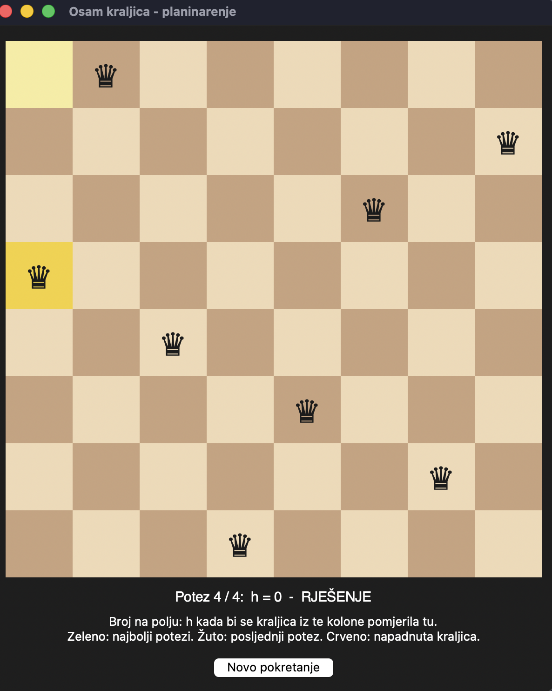

# Eight Queens Problem — Hill Climbing

A Python implementation of the classic **Eight Queens puzzle** solved with the **hill-climbing** local search algorithm, including an optional limit on *sideways moves*. The project provides a statistical comparison of the variants and an interactive step-by-step visualization of the search.

> This project was developed as part of the **fifth year of Master's studies at the School of Electrical Engineering** (Elektrotehnički fakultet).

---

## Table of Contents

- [Problem Description](#problem-description)
- [Approach](#approach)
- [Features](#features)
- [Requirements](#requirements)
- [Usage](#usage)
- [Configuration](#configuration)
- [Sample Results](#sample-results)
- [Visualization Guide](#visualization-guide)
- [Project Structure](#project-structure)
- [Notes](#notes)

---

## Problem Description

The goal is to place eight queens on a standard 8×8 chessboard so that no two queens attack each other, i.e. no two queens share a row, a column, or a diagonal.

The problem is a well-known benchmark in artificial intelligence. It is typically approached either with systematic search (e.g. backtracking) or, as in this project, with **local search**, which operates on complete states and iteratively improves them.

## Approach

### State representation

A state is a list of length `N` in which the element at index `c` holds the row of the queen placed in column `c`. This encoding guarantees exactly one queen per column, which removes column conflicts by construction and reduces the search space to `8^8` states.

### Heuristic function

`h(state)` is the number of pairs of queens that attack each other (directly or indirectly along a row or diagonal). A state with `h = 0` is a valid solution.

### Neighborhood

Two states are neighbors if they differ in the position of a single queen, which is moved to a different row within its own column. Every state therefore has `N · (N − 1) = 56` neighbors.

### Search algorithm

The implementation uses **steepest-ascent hill climbing** (here, steepest descent on `h`):

1. Start from a random state.
2. Evaluate all neighbors and select the minimum cost `best`.
3. If `best > h(current)` — a local minimum has been reached; the search stops.
4. If `best == h(current)` — a *sideways move* (plateau). It is allowed only up to `MAX_SIDEWAYS` consecutive times.
5. Otherwise the search moves to a better neighbor and the sideways counter is reset.
6. Ties are broken uniformly at random among all best moves.
7. The search ends when `h = 0` (solution found) or when it gets stuck.

Plain hill climbing (`MAX_SIDEWAYS = 0`) frequently stalls on local minima and plateaus. Permitting a bounded number of sideways moves lets the search traverse plateaus and raises the success rate substantially.

## Features

- Steepest-ascent hill climbing with a configurable sideways-move limit.
- Statistical evaluation over many random restarts, reporting success rate and average path length for both successful and failed runs.
- Interactive Tkinter visualization that replays a single run move by move, showing the heuristic value of every candidate move.
- Dependency-free: only the Python standard library is used.

## Requirements

- Python 3.8 or newer
- Tkinter (bundled with most Python distributions)

On some Linux distributions Tkinter must be installed separately, e.g.:

```bash
sudo apt install python3-tk
```

## Usage

```bash
python3 osam_kraljica.py
```

On launch the program:

1. Prints statistics for hill climbing **without** sideways moves.
2. Prints statistics for hill climbing **with** up to `MAX_SIDEWAYS` sideways moves.
3. Opens a window that animates a single run of the algorithm. The **Novo pokretanje** (*New run*) button starts a new run from a fresh random state.

## Configuration

Parameters are defined as constants at the top of [osam_kraljica.py](osam_kraljica.py):

| Constant        | Default | Description                                              |
| --------------- | ------- | -------------------------------------------------------- |
| `N`             | `8`     | Board size and number of queens                          |
| `MAX_SIDEWAYS`  | `100`   | Maximum number of consecutive sideways moves             |
| `RUNS`          | `200`   | Number of independent runs used for the statistics       |
| `SQUARE`        | `72`    | Size of a single board square in pixels                  |
| `DELAY_MS`      | `700`   | Pause between two moves in the animation (milliseconds)  |

## Sample Results

Output of a typical execution (results vary between runs because of random initialization):

```
Planinarenje sa najviše 0 sporednih poteza (200 realizacija)
  uspješnih realizacija:                    30 / 200 (15.0 %)
  prosječan broj poteza do tačnog rješenja: 3.90
  prosječan broj poteza kod neuspjeha:      3.04

Planinarenje sa najviše 100 sporednih poteza (200 realizacija)
  uspješnih realizacija:                    185 / 200 (92.5 %)
  prosječan broj poteza do tačnog rješenja: 18.55
  prosječan broj poteza kod neuspjeha:      70.40
```

| Variant                        | Success rate | Avg. moves (solved) | Avg. moves (failed) |
| ------------------------------ | ------------ | ------------------- | ------------------- |
| Without sideways moves         | ~15 %        | ~3.9                | ~3.0                |
| Up to 100 sideways moves       | ~92 %        | ~18.6               | ~70.4               |

Allowing sideways moves increases the success rate from roughly 15 % to over 90 %, at the cost of longer search paths.

## Visualization Guide



*A completed run: the algorithm found a valid placement (`h = 0`) in 4 moves.*

The graphical window displays the board at every step of the search:

- **Number on a square** — the value of `h` if the queen of that column were moved to that square.
- **Green circle** — the best available moves (lowest `h`).
- **Yellow square** — the queen's new position after the last move; the pale yellow square marks where it came from.
- **Red queen** — a queen that is currently under attack.
- **Status line** — current step, current value of `h`, a note when the move was sideways, and the final outcome (solution found or stuck).

## Project Structure

```
osam_kraljica/
├── osam_kraljica.py   # algorithm, statistics and visualization
├── images/
│   └── screenshot.png # screenshot used in this README
└── README.md
```

Main components of [osam_kraljica.py](osam_kraljica.py):

| Function / Class     | Purpose                                                          |
| -------------------- | ---------------------------------------------------------------- |
| `random_state()`     | Generates a random initial placement of the queens               |
| `attack()`           | Tests whether two queens attack each other                       |
| `h()`                | Heuristic: number of attacking pairs                             |
| `is_attacked()`      | Tests whether a given queen is attacked by any other queen       |
| `move_queen()`       | Returns a new state with one queen moved                         |
| `neighbor_costs()`   | Computes `h` for all neighboring states                          |
| `hill_climbing()`    | Runs the search and returns the full path of visited states      |
| `statistics()`       | Runs repeated experiments and prints aggregated results          |
| `Animation`          | Tkinter GUI that replays a run step by step                      |

## Notes

- The console output and the GUI labels are written in Serbian/Bosnian/Croatian, matching the language of the academic course for which the project was prepared.
- Hill climbing is an incomplete algorithm: a failed run does not imply that no solution exists, only that the search got stuck. Random restarts or a larger sideways limit can be used to improve reliability.
